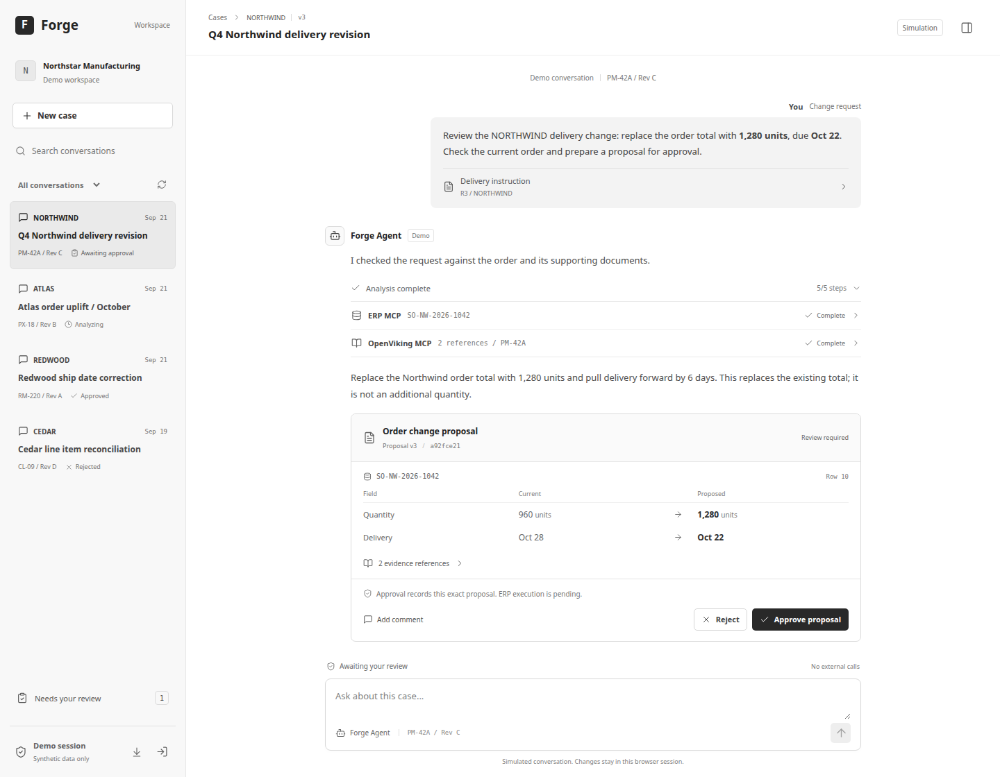

# ERP Agent

<div align="center">

### From changing requirements to decisions teams can trust.

**让制造变更有据可查，让每一步业务决策都由人把关。**

把客户变更、订单资料和生产上下文放进同一个案件工作区。AI 帮团队梳理证据、分析影响并准备方案；业务人员审核后，再决定下一步。

<p>
  
</p>

<sub>产品界面示意 · 合成制造案例数据</sub>

<br><br>

[产品流程](#从变更到决策) · [核心能力](#为真实业务边界而设计) · [系统架构](#系统架构) · [本地运行](#本地运行) · [项目文档](#项目文档)

</div>

---

## 从变更到决策

一张订单变更单，往往牵动交期、数量、物料和现场安排。ERP Agent 将这些线索放回同一个业务上下文：团队可以查看案件资料，让 Agent 对照 ERP 与受限知识来源整理影响，再把建议变成可审阅的方案。

```text
客户变更  →  资料与订单  →  影响分析  →  人工审核  →  后续执行跟踪
```

### 让每个建议都能回到依据

案件、附件、ERP 记录和分析过程围绕同一工作区组织。Agent 可以持续追问和补充分析，团队也能回看提案版本及其证据，不必把重要判断留在一次性的聊天里。

### 把决定权留在业务流程中

Agent 负责整理与建议，审批由人完成。后端负责权限、版本和业务状态检查；分析清单不是业务完成凭证，批准提案也不会绕过控制直接改写 ERP。

## 为真实业务边界而设计

- **案件化协作：** 对话、资料、建议和审核围绕具体业务案件持续保存。
- **有界的 Agent：** 通过受控工具读取案件和 ERP 信息，不向业务模型开放通用 Bash 或任意文件编辑。
- **可追溯的审核：** 提案保留版本与证据入口，审批绑定明确的方案内容。
- **独立的业务控制：** 身份、授权、幂等和 ERP 状态复核由后端执行。

## 项目进展

当前是持续开发中的 Demo。案件工作区、对话恢复、图片问答、ERPNext 只读接入和 Cube 运行时探针已有本地验证；生产部署、完整业务验收、文档持久解析、知识检索和 ERP 受控写入仍在建设或待验收。

<details>
<summary>查看各模块的验证范围</summary>

| 领域 | 已验证 | 仍在建设或待验收 |
| --- | --- | --- |
| 案件工作区 | 邮箱注册登录、个人数据隔离、会话保存、PostgreSQL 重启恢复 | 生产部署与正式账户管理 |
| Agent 对话 | JCode Rust Loop、DeepSeek Responses、连续工具调用、上下文压缩与恢复 | 长时间混合负载与完整业务验收 |
| 文件资料 | RustFS 私有原件、图片问答；多种文档的受限读取路径通过本地测试 | 各文档格式的真实模型验收、MinerU 持久解析 |
| ERP 与知识 | ERPNext 真实列表/明细只读、MCP 工具和权限链路 | 审批后的受控写入、OpenViking 索引与 RAG |
| 运行环境 | Cube 常驻 Harness 的恢复及并发探针 | 长期性能测量、生产级部署与故障演练 |

详见[当前实施状态](docs/plantree/plans/server-demo/implementation-status.md)和[项目路线图](docs/plantree/plans/server-demo/roadmap.md)。

</details>

## 系统架构

<p align="center">
  
</p>

<p align="center"><sub>沙箱内 JCode 运行方式的候选架构；部署位置仍以实测和架构记录为准。</sub></p>

## 技术栈

- **Web：** React、TypeScript
- **业务 API 与运行桥：** Rust、Axum、JCode
- **持久化与文件：** PostgreSQL、RustFS
- **演示 ERP：** ERPNext，通过受控 MCP 工具访问
- **沙箱：** CubeSandbox
- **规划中的知识链路：** OpenViking、MinerU

## 安全与业务边界

- 身份、授权、审批、幂等、ERP 状态检查和版本校验由后端负责。
- Agent 仅获得案件范围内的工具；通用 Bash 和任意文件编辑不向业务模型开放。
- ERP 读写需要区分授权与审批；当前演示已验证只读链路，ERP 写入尚未启用。
- 运行凭据和客户资料不应提交到仓库；本地密钥放在被忽略的运行配置中。

## 设计原则

- 自建 Web，采用 JCode 的 Rust Harness / Loop。
- CubeSandbox 纳入首版；优先验证沙箱内常驻 JCode/Bridge，同时对照外部 Harness，最终位置待实测。
- 数据库采用 PostgreSQL，不引入 PostgREST；自建后端统一使用 Rust，Web 保持 React/TypeScript。
- JCode 会话、消息、工具结果、todo、压缩检查点与个人记忆统一存入 PostgreSQL，文件不作为正式会话存储；真实长上下文压缩、原始消息保留和 API 重启恢复已验证，见[存储适配设计](docs/architecture/session-storage.md)。
- 保留 todo 与受控 read，关闭模型的通用 Bash 能力。
- ERP MCP 对接 ERPNext Demo；知识库使用 OpenViking，文档解析使用 MinerU。
- 批量解析使用持久队列与异步 Worker，在线交互与批处理独立控制并发。
- 审批、业务状态、幂等、权限与版本检查由沙箱外的后台执行。
- 高性能以整条链路的延迟、吞吐、资源和正确性实测为依据。

## 项目文档

- [架构说明](docs/architecture/erp-agent-demo-architecture.md)
- [项目计划与验证依据](docs/plantree/README.md)
- [当前实施状态](docs/plantree/plans/server-demo/implementation-status.md)
- [首个 Demo 路线图](docs/plantree/plans/server-demo/roadmap.md)
- [Cube 运行时部署方式调研](docs/architecture/cube-runtime-placement.md)
- [业务 Agent Prompt 草案](prompts/erp-agent-system-prompt.md)

## 目录

| 目录 | 职责 |
| --- | --- |
| `apps/web` | 对话、变更对比、证据、审批、todo 与执行台账 |
| `services/api` | 身份、案件、审批、执行记录、沙箱生命周期与 SSE |
| `services/runtime-bridge` | 受控 Rust 入口，调用 JCode 原生 Loop，通过私有管道传递回复与工具状态 |
| `services/mcp-gateway` | stdio MCP 工具、ERP 适配、知识检索范围校验 |
| `services/ingestion-worker` | 文件解析、校验、索引任务与幂等重试 |
| `packages/contracts` | 业务状态、API、工具与事件的共享契约 |
| `infra` | Cube 模板、ERPNext、OpenViking、模型及依赖部署 |
| `fixtures` | 可重置的合成民品案例与文档 |
| `prompts` | 受版本控制的业务提示词 |
| `skills/business` | 发布的业务指引、版本、关键词及工具依赖 |
| `docs` | 架构、决策、路线图和验收依据 |

`services/api` 是 Rust/Axum 后端，按领域目录组织：`auth`、`cases`、`conversation`、`agent_sessions`、`sandboxes`、`integrations`、`objects`、`permissions`、`platform` 与 `worker`；每个目录的 `mod.rs` 是该模块边界，函数只属于目录内部实现。数据库迁移集中在 `services/api/migrations`。模型任务使用 PostgreSQL 队列；Rust MCP 网关已接通，ingestion-worker 已包含即时 DOCX/XLSX/PDF/文本提取和解析配置，但尚无持久解析队列执行进程。JCode 的固定版本与后续更新方式见 [external](external/README.md)。

API crate 同时提供 library 和 binary：`services/api/src/lib.rs` 组装可测试的 `router(App)` 与服务生命周期，`services/api/src/main.rs` 仅调用 library 启动。模块单测跟随源码，服务级 Rust 集成测试位于 `services/api/tests/`，跨 API/Runtime/MCP/Cube 的多进程测试位于仓库级 `tests/system/`；见 [API 测试矩阵](services/api/TESTING.md)。

`mod.rs` 只声明和导出，`handlers.rs` 只处理 HTTP 适配。案件、会话、工具权限与原件/记忆模块已拆为 `application/` 用例、`domain.rs` 规则与 `repository/` 持久化；事务由用例控制，repository 不自行提交。其余模块仍有直接 SQL，尚未完成全项目分层。此次边界调整和本地回归见[记录](docs/plantree/plans/server-demo/api-module-boundaries.md)，不以目录改名代替职责分层。

## 本地运行

需要 Rust 工具链、Node.js 22.13+、Docker Compose。首次运行：

```sh
git submodule update --init --recursive
npm ci
npm run dev:init
npm run db:up
npm run db:migrate
npm run db:seed
npm run storage:up
npm run storage:init
npm run dev:api
```

API 默认 `http://127.0.0.1:3100`；`/health` 检查进程，`/ready` 检查数据库及迁移。登录信息由 `dev:init` 生成到权限为 0600 的本地 `.env`，不会输出到日志。另开终端执行 `npm run dev:web` 可访问业务 Web：`http://127.0.0.1:4173`。

未登录时首页只显示邮箱登录/注册。新账号进入空的个人工作区，可创建首个案件。有效登录刷新后保留；退出或服务端会话失效会返回登录页，并同步同一浏览器的其他标签页。

模型运行还需要 Rust 工具链：执行 `npm run agent:build`，在已忽略的 `.runtime/deepseek.env` 中配置专用 `DEEPSEEK_API_KEY`，权限设为 0600。`npm run dev:api` 自动加载此文件；默认地址为 `https://api.deepseek.com`，默认模型为 `deepseek-flash`，可用 `DEEPSEEK_MODEL` 显式选择。配置和运行约束见 [Runtime Bridge](services/runtime-bridge/README.md)。没有模型配置时只保存新输入，不排队补跑历史消息。

独立消费进程：先运行迁移，再以 `AGENT_WORKER_ENABLED=0 npm run dev:api` 启动 HTTP API，然后运行 `npm run dev:workers` 启动/重启 8 个用户级 Rust worker。启动脚本为每个 worker 设置 `AGENT_MAX_CONCURRENT_RUNS=8`，Rust 进程未显式设置时默认 4、最大 8；总槽位是进程数乘以单进程槽位，须结合模型、数据库和 Cube 实测调节。任务仍在一张 PostgreSQL `agent_runs` 表中持久化，多个 worker 由数据库通知唤醒并通过案件锁保持同一会话顺序。[受控 Runtime 调度探针](docs/plantree/plans/server-demo/agent-runtime-concurrency.md)与[真实 Cube/JCode 50 用户探针](docs/plantree/plans/server-demo/cube-resident-runtime.md)应分别解读。

本地 PostgreSQL 默认允许 200 个连接，可用 `POSTGRES_MAX_CONNECTIONS` 调整。API 和每个 worker 各有独立连接池；独立 worker 的默认池上限为 12，API 为 16，可用 `DATABASE_POOL_MAX_SIZE` 按进程覆盖，且池上限必须大于该进程的并发槽位。活跃 Agent 回合会持有案件锁连接；Cube guest 通过受限 HTTP 调用 Rust API，由 API 使用数据库池，guest 本身不直接连接 PostgreSQL；通知监听使用独立连接。[真实 50 用户探针](docs/plantree/plans/server-demo/agent-runtime-concurrency.md)在旧的 100 连接上限遇到连接耗尽，调整后才达到 50 路并发。连接数、内存和模型限流必须与槽位一起评估。

文档 RAG 的 embedding 推理服务使用本机 Docker Compose，模型缓存持久保留，HTTP 仅绑定 `127.0.0.1:8080`。先执行 `npm run dev:init` 补齐非敏感配置，`npm run embedding:pull` 仅拉取 TEI 镜像；`npm run embedding:up` 会启动 CPU 版并在首次运行时下载模型，目前按用户要求保持停止。装好 NVIDIA Container Toolkit 后可用 `npm run embedding:up:gpu`。模型就绪后，在 `embedding_models` 登记 BGE-M3 并运行 `npm run dev:embedding-worker`，具体命令见 [ingestion-worker 说明](services/ingestion-worker/README.md)。目前解析产物尚未接入文档队列，启动服务不等于 RAG 已可用。

`npm run check` 执行 Web 类型检查、Rust 构建、真实 PostgreSQL 集成测试和 Web 构建。测试创建并删除随机名称的独立数据库，连接用户需要 CREATEDB 权限；不会清空业务库。`npm run db:down` 停止本项目数据库并保留卷。

`npm run agent:test` 检查业务 Skill 边界；`npm run parser:test` 检查解析配置与异步接口 fixture，不调用真实解析服务。

API 契约和当前业务限制见 [services/api](services/api/README.md)。本地数据库账号是开发配置，不作为生产权限配置。

Cube 通过本地 `.env` 中的 `CUBE_API_URL`、`CUBE_TEMPLATE_ID` 和可选 `CUBE_PROXY_URL` 接入；存在 `.runtime/cube.env` 时，Rust API/Worker 启动后由该文件覆盖 Cube 配置。修改模板 ID 后必须重启运行进程，真实并发验收脚本会核对 Cube 实例实际使用的模板。运行版本、修复步骤及过期回收限制见 [infra/cube](infra/cube/README.md)。基础设施状态保留在后台，不显示在业务聊天中。本地验收依据见[联调记录](docs/plantree/plans/server-demo/web-api-integration.md)。

## 当前下一步

在 RustFS 原件上传和即时读取基础上实现 MinerU/视觉解析、文档持久任务和真实 OpenViking 检索。Cube 常驻 JCode 已通过同案件暂停恢复、销毁重建、旧 token 拒绝和 50 用户冷/暖两轮真实并发；当前模板的算术短提示虽然 100/100 完成，只有 93/100 回复正确，见[运行时记录](docs/plantree/plans/server-demo/cube-resident-runtime.md)。下一步转向 guest 资源指标、正确率对照、写操作断线、跨节点迁移和长期混合负载。当前开放 `case_read`、`attachment_read`、`todo`、`skill_find`、只读 `skill_manage`、受授权控制的 `memory_save`、`case_set_context`、`proposal_create`、独立的人工作业 `request_proposal_approval` 及四个 ERP/知识 MCP 工具；批准提案仍不执行 ERP 写入。

此项目由 2026-09-21 架构讨论初始化。实际目录为 `/home/axia/erp-agent`；原讨论产物保留。
