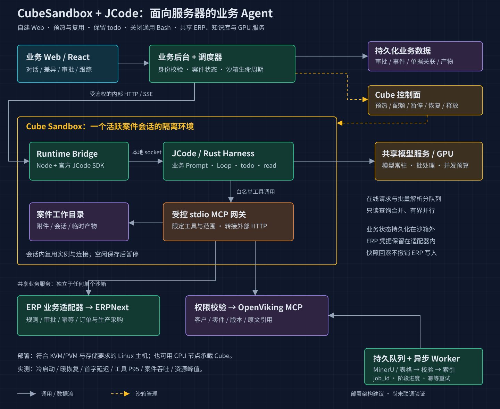

# ERP Agent

面向民品生产运营的服务器端智能体 Demo：客户需求变更 → 影响分析 → 人工确认 → ERP 执行跟踪。

当前状态：灰白 Chat Web 已通过 Rust 业务 API 接入 JCode Rust Loop 和 DeepSeek 原生 Responses API。个人邮箱注册/登录、用户隔离、RustFS 私有原件、真实案件读取、todo、连续对话、Skill 发现/加载、PostgreSQL 恢复和真实上下文压缩已验证。聊天附件可随消息持久绑定；PNG/JPEG/WebP 可经 RustFS 和 JCode 交给 DeepSeek Flash，即时图片问答已通过[真实合成图探针](docs/plantree/plans/server-demo/chat-attachment-agent-design.md)。PDF、DOCX、XLSX、MD、TXT 现有 Rust 即时读取路径和受限 `attachment_read` 续读工具，解析器与授权链路通过本地测试，尚未完成真实模型对每种格式的逐一验收。ERP/OpenViking 两个 Rust MCP 服务及四个工具已注册，真实 ERPNext 列表/明细读取通过；TEI 本地 Docker 配置已添加但尚未完成镜像/模型下载与推理验收，OpenViking 服务、持久索引和 RAG 仍未完成。模型/思考程度、输入框自增高、真实停止和三种操作授权已实现；当前回合的授权上下文会注入 JCode，并由 `case_read` 返回，业务审批单独要求人工 approver。默认回合总时限已关闭，流式中断和恢复修复见[验证记录](docs/plantree/plans/server-demo/stream-recovery-fix.md)。本地 Cube v0.7.2 常驻 Harness 已完成合成案件首轮、续轮、API/Worker 重启后续轮，以及两次独立的暂停恢复和销毁重建续轮；宿主机路径保留用于对照，单实例多次暂停、50 用户容量和完整业务验收仍待验证。

## 已确定方向

- 自建 Web，采用 JCode 的 Rust Harness / Loop。
- CubeSandbox 纳入首版；优先验证沙箱内常驻 JCode/Bridge，同时对照外部 Harness，最终位置待实测。
- 数据库采用 PostgreSQL，不引入 PostgREST；自建后端统一使用 Rust，Web 保持 React/TypeScript。
- JCode 会话、消息、工具结果、todo、压缩检查点与个人记忆统一存入 PostgreSQL，文件不作为正式会话存储；真实长上下文压缩、原始消息保留和 API 重启恢复已验证，见[存储适配设计](docs/architecture/session-storage.md)。
- 保留 todo 与受控 read，关闭模型的通用 Bash 能力。
- ERP MCP 对接 ERPNext Demo；知识库使用 OpenViking，文档解析使用 MinerU。
- 批量解析使用持久队列与异步 Worker，在线交互与批处理独立控制并发。
- 审批、业务状态、幂等、权限与版本检查由沙箱外的后台执行。
- 高性能以整条链路的延迟、吞吐、资源和正确性实测为依据。

## 从这里继续

1. 阅读 [AGENTS.md](AGENTS.md)。
2. 阅读 [计划入口](docs/plantree/README.md) 和 [首个 Demo 路线图](docs/plantree/plans/server-demo/roadmap.md)。
3. 查看 [两种 Cube 部署方式的调研](docs/architecture/cube-runtime-placement.md)、[完整架构](docs/architecture/erp-agent-demo-architecture.md) 和 [业务 Prompt 草案](prompts/erp-agent-system-prompt.md)。

下图为沙箱内方案，属于候选部署设计，不代表已部署。



## 目录

| 目录 | 职责 |
| --- | --- |
| `apps/web` | 对话、变更对比、证据、审批、todo 与执行台账 |
| `services/api` | 身份、案件、审批、执行记录、沙箱生命周期与 SSE |
| `services/runtime-bridge` | 受控 Rust 入口，调用 JCode 原生 Loop，通过私有管道传递回复与工具状态 |
| `services/mcp-gateway` | stdio MCP 工具、ERP 适配、知识检索范围校验 |
| `services/ingestion-worker` | 文件解析、校验、索引任务与幂等重试 |
| `packages/contracts` | 业务状态、API、工具与事件的共享契约 |
| `infra` | Cube 模板、ERPNext、OpenViking、模型及依赖部署 |
| `fixtures` | 可重置的合成民品案例与文档 |
| `prompts` | 受版本控制的业务提示词 |
| `skills/business` | 发布的业务指引、版本、关键词及工具依赖 |
| `docs` | 架构、决策、路线图和验收依据 |

`services/api` 是 Rust/Axum 后端，按领域目录组织：`auth`、`cases`、`conversation`、`agent_sessions`、`sandboxes`、`integrations`、`objects`、`permissions`、`platform` 与 `worker`；每个目录的 `mod.rs` 是该模块边界，函数只属于目录内部实现。数据库迁移集中在 `services/api/migrations`。模型任务使用 PostgreSQL 队列；Rust MCP 网关已接通，ingestion-worker 已包含即时 DOCX/XLSX/PDF/文本提取和解析配置，但尚无持久解析队列执行进程。JCode 的固定版本与后续更新方式见 [external](external/README.md)。

API crate 同时提供 library 和 binary：`services/api/src/lib.rs` 组装可测试的 `router(App)` 与服务生命周期，`services/api/src/main.rs` 仅调用 library 启动。模块单测跟随源码，服务级 Rust 集成测试位于 `services/api/tests/`，跨 API/Runtime/MCP/Cube 的多进程测试位于仓库级 `tests/system/`；见 [API 测试矩阵](services/api/TESTING.md)。

`mod.rs` 只声明和导出，`handlers.rs` 只处理 HTTP 适配。案件、会话、工具权限与原件/记忆模块已拆为 `application/` 用例、`domain.rs` 规则与 `repository/` 持久化；事务由用例控制，repository 不自行提交。其余模块仍有直接 SQL，尚未完成全项目分层。此次边界调整和本地回归见[记录](docs/plantree/plans/server-demo/api-module-boundaries.md)，不以目录改名代替职责分层。

## 本地运行

需要 Rust 工具链、Node.js 22.13+、Docker Compose。首次运行：

```sh
git submodule update --init --recursive
npm ci
npm run dev:init
npm run db:up
npm run db:migrate
npm run db:seed
npm run storage:up
npm run storage:init
npm run dev:api
```

API 默认 `http://127.0.0.1:3100`；`/health` 检查进程，`/ready` 检查数据库及迁移。登录信息由 `dev:init` 生成到权限为 0600 的本地 `.env`，不会输出到日志。另开终端执行 `npm run dev:web` 可访问业务 Web：`http://127.0.0.1:4173`。

未登录时首页只显示邮箱登录/注册。新账号进入空的个人工作区，可创建首个案件。有效登录刷新后保留；退出或服务端会话失效会返回登录页，并同步同一浏览器的其他标签页。

模型运行还需要 Rust 工具链：执行 `npm run agent:build`，在已忽略的 `.runtime/deepseek.env` 中配置专用 `DEEPSEEK_API_KEY`，权限设为 0600。`npm run dev:api` 自动加载此文件；默认地址为 `https://api.deepseek.com`，默认模型为 `deepseek-flash`，可用 `DEEPSEEK_MODEL` 显式选择。配置和运行约束见 [Runtime Bridge](services/runtime-bridge/README.md)。没有模型配置时只保存新输入，不排队补跑历史消息。

独立消费进程：先运行迁移，再以 `AGENT_WORKER_ENABLED=0 npm run dev:api` 启动 HTTP API，然后运行 `npm run dev:workers` 启动/重启 8 个用户级 Rust worker。每个 worker 的 `AGENT_MAX_CONCURRENT_RUNS` 默认 4、最大 8；总槽位是进程数乘以单进程槽位，须结合模型、数据库和 Cube 实测调节。任务仍在一张 PostgreSQL `agent_runs` 表中持久化，多个 worker 由数据库通知唤醒并通过案件锁保持同一会话顺序。[50 用户本地探针](docs/plantree/plans/server-demo/agent-runtime-concurrency.md)只验证受控 Runtime 的调度，不代表真实模型或 Cube 业务容量。

本地 PostgreSQL 默认允许 200 个连接，可用 `POSTGRES_MAX_CONNECTIONS` 调整。API 和每个 worker 各有独立连接池，活跃 Agent 回合会持有案件锁连接；[真实 50 用户探针](docs/plantree/plans/server-demo/agent-runtime-concurrency.md)在旧的 100 连接上限遇到连接耗尽，调整后才达到 50 路并发。连接数、内存和模型限流必须与槽位一起评估。

文档 RAG 的 embedding 推理服务由本机 Docker Compose 单独运行，模型缓存持久保留，HTTP 仅绑定 `127.0.0.1:8080`。先执行 `npm run dev:init` 补齐非敏感配置，再用 `npm run embedding:up` 启动 CPU 版 TEI；装好 NVIDIA Container Toolkit 后可改用 `npm run embedding:up:gpu`。模型就绪后，在 `embedding_models` 登记 BGE-M3 并运行 `npm run dev:embedding-worker`，具体命令见 [ingestion-worker 说明](services/ingestion-worker/README.md)。目前解析产物尚未接入文档队列，启动服务不等于 RAG 已可用。

`npm run check` 执行 Web 类型检查、Rust 构建、真实 PostgreSQL 集成测试和 Web 构建。测试创建并删除随机名称的独立数据库，连接用户需要 CREATEDB 权限；不会清空业务库。`npm run db:down` 停止本项目数据库并保留卷。

`npm run agent:test` 检查业务 Skill 边界；`npm run parser:test` 检查解析配置与异步接口 fixture，不调用真实解析服务。

API 契约和当前业务限制见 [services/api](services/api/README.md)。本地数据库账号是开发配置，不作为生产权限配置。

Cube 通过本地 `.env` 中的 `CUBE_API_URL`、`CUBE_TEMPLATE_ID` 和可选 `CUBE_PROXY_URL` 接入；运行版本、修复步骤及过期回收限制见 [infra/cube](infra/cube/README.md)。基础设施状态保留在后台，不显示在业务聊天中。本地验收依据见[联调记录](docs/plantree/plans/server-demo/web-api-integration.md)。

## 当前下一步

在 RustFS 原件上传和即时读取基础上实现 MinerU/视觉解析、文档持久任务和真实 OpenViking 检索。Cube 常驻 JCode 已通过同案件暂停恢复、销毁重建、旧 token 拒绝和 50 用户冷/暖两轮真实并发；下一步转向写操作断线、跨节点迁移、长期混合负载及宿主机对照。当前开放 `case_read`、`attachment_read`、`todo`、`skill_find`、只读 `skill_manage`、受授权控制的 `memory_save`、`case_set_context`、`proposal_create`、独立的人工作业 `request_proposal_approval` 及四个 ERP/知识 MCP 工具；批准提案仍不执行 ERP 写入。

此项目由 2026-09-21 架构讨论初始化。实际目录为 `/home/axia/erp-agent`；原讨论产物保留。
