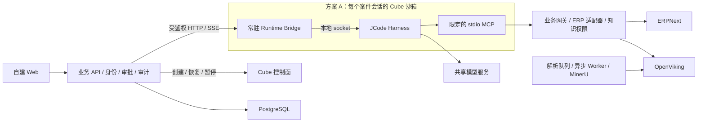

# JCode 放在 Cube 内还是外

调研日期：2026-09-21；实施状态复核：2026-09-25。当前方案 A 的真实 Cube/JCode
合成回合、恢复和短时并发已验证；方案 B 仍保留作同口径性能对照，尚无完成的 A/B 测量。

结论：两种方式均有 Cube 官方示例。结合本项目保留 JCode 完整 Harness、会话状态和案件文件的选择，优先验证“JCode + 常驻 Bridge 在 Cube 内”；保留外部运行作为性能对照。最终位置由隔离需求、恢复正确性和实测开销决定，不把之前架构图中的位置当作不可修改的决定。

## 1. 官方依据

Cube 官方仓库转载的[团队负责人访谈](https://github.com/TencentCloud/CubeSandbox/blob/master/docs/zh/blog/posts/2026-08-13-cubesandbox-agent-infra-interview.md)区分了工具执行隔离、有状态 Agent Harness 托管、Agent 所访问服务的托管三类需求。它没有要求所有 Agent 必须放入沙箱。

| 方式 | 官方材料 | 实际边界 |
| --- | --- | --- |
| Agent 在外，工具执行在内 | [LangChain 示例](https://github.com/TencentCloud/CubeSandbox/tree/master/examples/langchain-integration)及其 [1.x 源码](https://github.com/TencentCloud/CubeSandbox/blob/master/examples/langchain-integration/1.x/langchain_agent_demo.py) | 宿主运行 Agent/模型调用，执行工具使用 Sandbox 文件与命令 API；整个 run 复用一个沙箱 |
| 整个 Agent 在内 | [Pi 接入](https://github.com/TencentCloud/CubeSandbox/blob/master/docs/guide/integrations/pi-agent.md)、[Hermes 实例](https://github.com/TencentCloud/CubeSandbox/blob/master/docs/guide/usecases/hermes-agent.md) | Agent 进程、工作目录、会话状态进入 MicroVM，外部调用模型服务 |
| 在内且预先初始化 | [预热服务教程](https://github.com/TencentCloud/CubeSandbox/blob/master/docs/guide/tutorials/prewarm-template-service.md)、[Pi 常驻适配器](https://github.com/TencentCloud/CubeSandbox/blob/master/examples/pi-agent-integration/pi_warmup_adapter.mjs) | 模板启动常驻 SDK 服务，完成 AgentSession 初始化后探针成功，保存进程和内存，恢复后接收任务 |

预热示例与自建 Runtime Bridge 最接近；它证明一种实现模式，不证明 JCode 已兼容。示例适配器的 HTTP 接口没有本项目所需的用户鉴权，不能直接作为产品服务使用。

原始调研的源码核对点：Cube `9d73cfd41212f45f4ff0d4a9038f91a585c0fa9a`；
JCode `2a4edaa02057ac994a601311c4f03ed450e1b3c9`。当前本地 Cube CLI 是 v0.7.2，
本仓库 JCode submodule 的检出提交为 `6819cf87acdc6cc4e2c2c321148eb59c04d82749`
并有未提交的会话存储改动；不能把原调研提交误当作当前运行版本。链接使用
upstream master 方便浏览，实施应核对本地固定版本。

## 2. 两种部署

方案 B 将图中 Bridge/JCode/stdio MCP 移到宿主的专用进程或容器，只有确实需要隔离的工具执行通过 Cube API 进入沙箱。它不会天然隔离外面的 JCode 进程、内存或会话目录；单独的 jcodeHome 也不构成操作系统安全边界。

| 项目 | A：JCode 在 Cube 内 | B：JCode 在外，调用 Cube 工具 |
| --- | --- | --- |
| 隔离范围 | Harness 进程、会话文件和工具运行环境 | 仅送入 Cube 的操作 |
| 常驻在线路径 | API → Bridge → JCode → MCP → 服务 | API → JCode → MCP → 服务；需要时才进 Cube |
| 空闲恢复 | 恢复沙箱后检查会话、连接、凭据 | JCode 生命周期由应用管理，工具沙箱单独恢复 |
| 代价 | 每活跃实例资源、创建/恢复等待、跨边界请求 | 宿主 runtime 调度和隔离由我们补齐，可能少一段网络调用 |
| 对本项目的价值 | 完整复用已有 Harness 的状态和执行环境隔离 | 仅 MCP 且没有可执行工具时，交互路径可以不经过 Cube |

两种方案都可以调用 Cube API。“是否调用 API”和“JCode 在哪里运行”是两个问题。方案 A 的创建/暂停由业务后台调用控制面，业务任务通过沙箱应用端口进入 Bridge；每个 token 或 MCP 工具调用不必经过创建接口。

本项目的优先验证项是 A，因为用户已选择复用完整 JCode 并希望通过 Cube 隔离。若实测发现只有受控远程 MCP，且进程级隔离并非必要，B 是合理简化方案。关闭 Bash 降低了工具执行沙箱的必要性，但不自动消除会话文件和运行时进程的隔离需求。

后续已确认的存储约束：两种方式的 JCode 会话均以 PostgreSQL 为唯一持久来源，不使用本地 JSON/journal 保存正式历史。表中“会话文件”仅描述上游默认能力；本产品将其替换为[数据库存储接口](session-storage.md)。Cube 快照只加速运行环境恢复，数据库中的租约/版本仍决定哪一实例可继续写入。

## 3. 性能实现约束

- 一次活跃案件复用一个常驻 Bridge/JCode 实例；不按消息启动进程，不按 MCP 调用创建沙箱。
- 模板预装固定版本依赖。先验证 JCode 能在没有用户凭据时初始化；不能初始化的部分移到恢复后的绑定阶段，不为追求预热而把密钥或客户资料装进模板。
- 预热探针必须表示 SDK/运行时可接收任务，不能只检查 envd 健康。恢复后为实例绑定独立业务身份、案件目录与受限凭据，校验模板克隆没有复用业务 session ID。
- 首版一个沙箱同时运行一个案件轮次，后台排队并记录持久任务；并发请求不得静默混入同一会话。
- 活跃 MCP/模型连接复用；恢复后重建失效的外部连接，重新订阅事件。业务事件游标来自 PostgreSQL，不能假设 SDK 提供持久重放。
- ERP、OpenViking、PostgreSQL、解析 Worker 和 GPU 模型常驻沙箱外；各会话不重复加载 GPU 模型。

[生命周期文档](https://github.com/TencentCloud/CubeSandbox/blob/master/docs/guide/lifecycle.md)给出 `on_timeout=pause` 与 `auto_resume=true` 的空闲暂停方案。默认超时策略可能是 kill，主动 pause 也不等于取消原有销毁 TTL，必须按固定版本设置和验证。审批等待可以暂停，尚未完成的外部写入要先留下执行记录，恢复时查询 ERP 结果。

暂停会打断对外连接。`paused_resource_release_ratio` 默认 0 时，释放物理内存不等于释放调度配额；调高释放比例后，恢复可能因容量不足被拒绝。快照仍占磁盘。容量预算必须同时统计活跃内存、暂停实例配额和快照存储。

## 4. 延迟验证方法

不承诺固定毫秒数。Cube 的[2026-06-01 基准](https://github.com/TencentCloud/CubeSandbox/blob/master/docs/blog/posts/2026-06-01-cubesandbox-perf-benchmark.md)报告的是作者环境下的基础 sandbox-code：96 逻辑核、375 GiB 内存、NVMe/XFS，2 vCPU/2 GiB 沙箱。创建 P95 在串行时为 57.4 ms，在并发 50 时为 508.4 ms；批量耗时除以数量的约 5 ms 不是单个请求延迟，也不是本项目 JCode 就绪时间。

对照固定同一 JCode commit、模型/参数、Prompt、工具集合、输入和资源限额，测试四种状态：B 的常驻进程、A 的活跃实例、A 从干净预热模板创建、A 从已有案件暂停恢复。

| 测试 | 记录 | 用途 |
| --- | --- | --- |
| 带鉴权的空请求回环 | P50/P95/P99，错误率 | 分离 Bridge/网络开销，不调用模型 |
| 从请求到业务 ready | 排队、创建/恢复、绑定身份、MCP 可用时间 | 避免只报告 VM 或端口启动时间 |
| 固定只读 ERP/知识工具序列 | 工具数、各段耗时、重复查询、正确性 | 控制模型波动，比较实际 I/O 代价 |
| 相同完整分析任务 | TTFT、总耗时、token、CPU/RSS、成功率 | 比较用户感知性能 |
| 并发唤醒与混合解析负载 | 尾延迟、拒绝/排队率、恢复失败、GPU 占用 | 确认容量和在线/离线资源争用 |
| 断线后恢复及重复提交 | 会话/租户不串、事件不漏、ERP 不重复写 | 性能数据必须伴随正确性 |

先确定期望并发和可接受响应时间，再用测量决定是否采用 A。开发机测试只能说明开发机表现，不能替代客户 GPU 服务器的验收。

## 5. 业务边界不随放置位置改变

审批绑定方案版本和动作摘要，后台重新核对 ERP 状态后才能执行；Cube 快照无法撤销外部 ERP 写入。ERP 高权限凭据留在适配器，Agent 仅获得限定作用域的工具凭据。Cube 控制面不向浏览器或模型公开，产品工具仍然禁止通用 Bash。

OpenViking/MinerU 保持独立服务。入库任务由持久队列和 Worker 处理，不让 JCode 会话长时间等待解析。原件、审计、业务状态和正式产物保存在沙箱外。

## 6. 当前实施事实

PostgreSQL 上的身份、案件、方案、审批、审计 API 已实现；`AGENT_RUNTIME_MODE=resident`
的 Bridge 在 Cube guest 内复用 JCode Agent、PostgreSQL session、技能目录和受控 MCP
注册表。业务 API/Worker 已通过案件绑定租约和短期 token 调用 guest。真实本地证据包括
首轮/同实例续轮、API/Worker 重启后续轮、暂停恢复、销毁重建续轮、双案件隔离，以及
50 用户各自独立实例的短提示冷/暖回合；范围、样本和异常见
[Cube 常驻运行时记录](../plantree/plans/server-demo/cube-resident-runtime.md)。

当前 Worker 以 PostgreSQL `agent_runs` 排队，多个进程消费；同一案件有唯一活跃运行
约束和 advisory lock。八个独立 Worker 各配置八槽，本地 PostgreSQL 连接上限 200，
API/Worker 默认池分别为 16/12；这些值对应本机短负载实测，不是生产容量。
`AGENT_TURN_TIMEOUT_SECONDS=0` 默认不设总回合截止；Cube ready 等待单独配置，
ERP/知识 HTTP 工具有各自请求超时。模型请求、工具、沙箱启动与客户端连接仍需按
长期和混合负载梳理独立策略，不能用单个 150 秒截止代替。

真实 OpenViking 索引与检索、异步解析、ERP 写入、跨节点恢复、长期混合负载，以及
方案 B 相同模型/提示/工具的延迟和资源对照仍未验收。2026-09-25 本地 Cube 旧模板
实际以 root 运行的偏差已通过入口降权和新模板真实探针修复；临时 Bash 工具已关闭，
细节见上述运行时记录。
