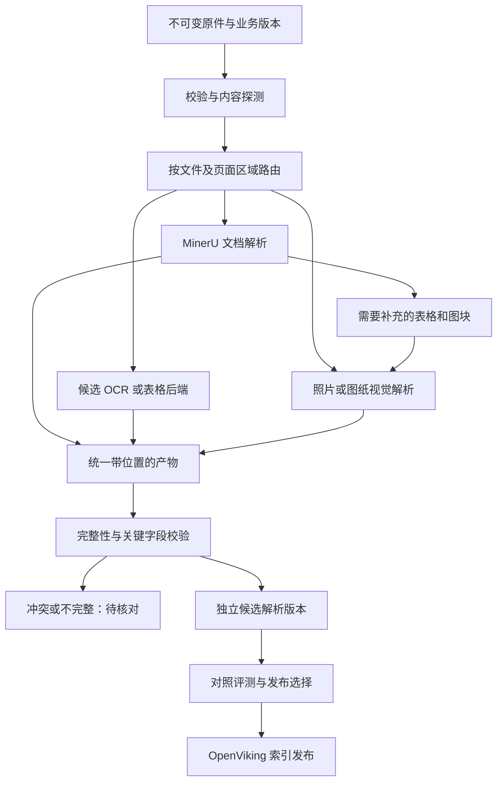

# 可替换解析器与父子产物设计

日期：2026-09-22。模式：execute-ready。Rust 接口与配置继承已实现并通过 5 项固定样本测试，见 [Worker](../../../../services/ingestion-worker/README.md)。真实解析适配器、持久任务、统一证据产物和可运行 Worker 尚未实现；下文其余部分仍是后续设计。

相关：[RAG 基础](rag-foundation.md)、[Skill 与工具](skill-tool-design.md)、[开源实践](rag-references.md)。沿用异步 Worker、PostgreSQL 任务和持久原件，模型服务位于案件沙箱外。

## 三种关系分开建模

| 关系 | 例子 | 用途 |
| --- | --- | --- |
| 配置继承 | `document-base` -> `scan-mineru`；`scan-mineru` -> `scan-mineru-vision` | 复用超时、产物要求和处理步骤，只覆盖要测试的模型/阶段 |
| 任务与派生产物 | 原 PDF -> 第 3 页 -> 表格区域 -> OCR/视觉结果 | 追踪父输入、子任务、坐标转换与失败恢复 |
| 文档结构 | 文档 -> 章节/页 -> 表格 -> 行/单元格 | 保留上下文，支持检索后深读和引用 |

Rust 的实现采用 trait、组合和显式配置继承，不建立多层类继承。不同模型实现共同接口，流水线负责共同生命周期；配置继承与运行时任务树互相独立。组合结果可能依赖多个父产物，血缘使用有向无环图而不强行限制为单父树。

## 解析流水线



路由可到页/区域，同一页能同时有文本、表格和图片。MinerU 已提供满足要求的 OCR/布局时复用已有产物，只有特定缺失或对照模式才再跑另一个解析器。XLSX 优先直接读取表格结构，不先转图片再 OCR。

公共流程属于 Rust Worker：输入校验、文件访问、预处理/坐标变换记录、任务提交与轮询、限流、重试、原始产物落盘、规范化、质量门槛和发布。适配器负责后端的协议、能力声明和结果映射；其内部可以是 Python 服务或厂商 API。

## Rust 接口草案

复用当前 Rust 工具的 `async-trait` 风格以便使用 `Arc<dyn ParseBackend>`。已编译接口位于 [backend.rs](../../../../services/ingestion-worker/src/backend.rs)，以下省略能力参数与选项校验细节。异步远程任务与同步返回使用同一结果类型；句柄可序列化，真正写入 PostgreSQL 和恢复调度仍待实现。

```rust
#[async_trait]
pub trait ParseBackend: Send + Sync {
    fn capabilities(&self) -> &ParserCapabilities;
    async fn submit(&self, request: &ParseRequest) -> Result<Submission, ParseError>;
    async fn poll(&self, handle: &RemoteJob) -> Result<JobProgress, ParseError>;
    async fn cancel(&self, handle: &RemoteJob) -> Result<CancelOutcome, ParseError>;
}

pub enum Submission {
    Ready(RawArtifactManifest),
    Pending(RemoteJob),
}
```

- `ParserCapabilities`：接受的 MIME、整页/区域/批量支持、文字/表格/坐标/图片能力、页数限制、异步/取消/远程幂等支持；不宣称通用模型准确率。
- `ParseRequest`：内部授权范围、原件引用与哈希、输入范围、完整解析配置哈希、模型/引擎版本、幂等键、期限；不接受模型指定任意 URL、shell 或存储路径。
- `RemoteJob`：后端、远程 ID、提交键和非敏感恢复信息，写入 PostgreSQL；密钥只通过服务端配置引用取得。
- `RawArtifactManifest`：原始响应、输出文件哈希/长度、覆盖页和缺失项；保存后再由规范化模块生成统一产物。新模型优先复用其后端协议适配器，不为每个模型复制一套实现。
- `ParseError`：输入不支持、认证/配置、容量/限流、暂时不可用、永久失败、部分结果、状态不明；重试策略依据类型，不把所有错误等同于可重试。

首版后端注册使用编译期注册表加运行时配置；不引入动态库插件系统。HTTP 客户端、并发额度和模型连接在 Worker 内共享，GPU 服务暖实例复用，不每份文件重新加载模型。

## 单父配置继承与固定版本

以下为候选配置形状，profile/model 引用均为示例名，不代表已部署模型：

```json
{
  "schema_version": 1,
  "profiles": [
    {
      "id": "document-base@1",
      "abstract": true,
      "settings": {"timeout_seconds": 180, "retain_original": true},
      "steps": {
        "extract": {"enabled": true},
        "vision": {"enabled": false},
        "validate": {"enabled": true, "ruleset": "industrial-evidence@1", "depends_on": ["extract"]}
      }
    },
    {
      "id": "scan-mineru@1",
      "extends": "document-base@1",
      "steps": {
        "extract": {"backend": "mineru", "model_ref": "mineru-default@1"}
      }
    },
    {
      "id": "scan-mineru-vision@1",
      "extends": "scan-mineru@1",
      "steps": {
        "vision": {"enabled": true, "backend": "vision", "model_ref": "vision-candidate@1", "depends_on": ["extract"]},
        "validate": {"depends_on": ["vision"]}
      }
    }
  ]
}
```

解析规则必须固定：单父继承；检测环和缺失引用；`id/extends/abstract` 是本层元数据，不从父层继承，`abstract` 默认 false。`steps` 按稳定步骤 ID 合并，类型不一致/未知字段报错；数组整体替换，`null` 不表示删除，禁用步骤显式 `enabled=false`。每个后端配置按自身 schema 校验；切换 `backend` 时重置旧后端专属 options，再应用新 options，并验证模型引用与新后端兼容。控制节点依赖的是步骤状态与输入产物，不依赖 JSON 字段书写顺序。

以上配置规则已在 [profile.rs](../../../../services/ingestion-worker/src/profile.rs)实现，首版只接受 extract/vision/validate 三个稳定阶段；切换后端时也清除原 model_ref，要求提供兼容的新引用。validate 必须直接或间接依赖所有启用的解析步骤；未知/禁用依赖、依赖环和空校验规则均拒绝。上述 mineru/vision 为设计示例，当前测试只注册 fixture 后端，不表示这些服务已可执行。

先展开父配置并完成能力/依赖校验，再生成规范化 JSON 和哈希，保存完整不可变快照。可执行 profile 不能缺少必须的后端或模型；abstract profile 不能直接排队。默认配置变更仅影响新任务，重试必须使用原快照；有意换模型则新建解析运行。权限、租户、输出存储根和发布授权不参与继承，不可被子配置覆盖。

## 产物与运行记录

| 实体 | 关键字段和语义 |
| --- | --- |
| `document_revision` | 业务文档版本、客户/项目/料号/修订/有效期和原件哈希；更换解析模型不创造新的业务修订 |
| `parse_run` | 运行 ID、revision、profile 快照/哈希、实际引擎/模型/提示词版本、运行模式、状态与覆盖率 |
| `parse_step` / `attempt` | 稳定步骤、依赖输入、尝试次数、租约/fencing、远程任务句柄；记录时间、成本和错误 |
| `artifact` / `artifact_edge` | 不可变产物、一个或多个父输入、变换/提取方式、源文件哈希、内容哈希和格式版本 |
| `evidence_block` | 运行/产物内稳定块 ID、类型、原文、表格结构、页/单元格/坐标、文档父节点、来源 locator |
| `index_release` | 一组经过校验的解析产物清单及 OpenViking 路径、embedding/切块配置、索引任务状态和发布指针 |

表名为候选数据契约，迁移前需与现有领域命名统一。原始文件、模型原始响应、规范化 JSON 和缩略图保存在持久产物存储；PostgreSQL 保存元数据、任务与映射，不把大文件塞入 JCode 会话。

图片坐标记录坐标系、宽高、旋转和切片到原件的变换；表格保留表头、合并单元格、行列及原始文字。统一产物分别记录提取文字、模型解释和业务确认，不用视觉生成文字覆盖 OCR 原文。不同解析运行的块号不保证对应，通过原件区域和业务字段对齐比较。

索引与引用包含 `revision_id + parse_run_id + artifact_id + block_id`。引用在 API 校验后解析为页面/区域；同一业务版本可以有多份解析候选，但正式查询只使用已选择的发布清单，不把实验分支混入结果。被授权的评测可以显式指定候选清单。

## 三种执行模式

1. `single`：一个 profile，可以包含多个顺序/并行阶段，例如 MinerU 提取后只对未识别图块做视觉补充。
2. `fallback`：遇到明确的输入不支持或质量门槛未通过，按策略跑备用 profile；记录触发原因和两个结果。不因认证失败、权限拒绝自动改走其他外部服务。超时先查任务状态再决定后续动作。
3. `compare`：对同一原件分别运行 A/B profile，独立保存结果与成本。重复实验使用独立 `replicate_id`，不能命中旧结果缓存冒充重新运行；记录参数及后端支持时的随机种子，不支持固定种子则报告波动。生产发布不自动选择得分最高者，更不拼接两边有利结果冒充单模型输出。

组合阶段需要明确规则：来源页/区域不同的内容可以合并；同一区域数量、日期、尺寸或单位冲突时保留候选与证据并标记 `needs_review`，不平均数字，也不以两模型一致代替正确性验证。派生合成结果记录所有输入运行，保持可追溯。

## 恢复、幂等与发布

入库沿用 PostgreSQL 持久任务和租约。步骤幂等键由授权范围、revision、输入产物哈希、profile 哈希、步骤 ID 和实验重复标识构成；普通入库使用固定重复标识，同一次运行重试保持标识不变。远程服务支持幂等键时一并传递。若上游不支持，提交成功但尚未保存句柄的中断窗口不能宣称恰好一次：进入状态核对/人工重试流程，避免盲目重复付费提交。

每次状态提交和最终发布校验当前租约版本，过期 Worker 不能完成任务。取消首先撤销发布资格，再尽力取消远程任务；远程取消不支持时记录仍可能产生费用，迟到产物不能自动发布。必需子步骤都完成且质量门槛通过才进入索引；允许缺失的可选输出显式列入产物清单。

索引发布使用独立目标路径和事务性指针切换。评测结果不改变业务版本有效期；撤回资料不能因回退解析版本重新生效。失败重试复用成功步骤，先核对远程/索引任务再提交，原件与既有有效发布保留。

## 对照评测与首批落地

先做两个轴，避免同时换全部配置而无法归因：

- 解析轴：固定原件、题目、检索策略和回答模型，比较 MinerU 单独解析、MinerU 加视觉补充、候选替代解析器。分别记录数字/单位/料号/修订、表格结构、区域定位、缺失页、延迟和成本。
- 检索轴：固定解析产物、embedding 和回答模型，比较基础召回、OpenViking 分层召回以及检索后深读。记录证据召回、引用正确率、拒答和客户/版本隔离。

可复用原有约 40 题合成基线，并保留未用于调参的验收题。混合负载单独记录批量解析吞吐与在线检索 p50/p95，不能用解析器报告的平均耗时替代端到端表现。

首批顺序：定义统一产物/配置解析 -> 用固定产物验证适配契约 -> 接一个真实 MinerU 服务 -> 接一个视觉补充适配 -> 验证 A/B 结果、定位和重启恢复 -> 接上传与 OpenViking 发布。备用 OCR 型号可以稍后添加；此时协议和试验分支已经支持扩展，不需要修改 Agent Skill 或重新设计业务 UI。

执行前仍需确认的实测项：MinerU 版本与 `/file_parse`/新接口兼容、坐标及远程任务恢复；专用视觉/embedding 服务；照片/图纸样本的实际质量。Worker 优先 Rust 已确定，具体服务型号不在本文假定已配置。
