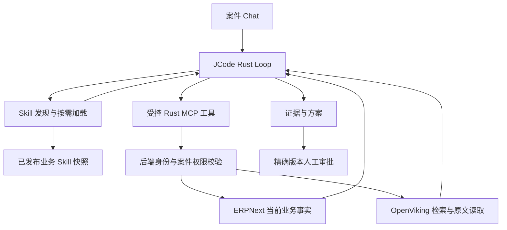

# Skill 引导与业务工具设计

日期：2026-09-22。模式：execute-ready。项目 Skill 查找/加载、受控目录、提示词、PostgreSQL 版本记录和 Web 工具标签已实现；ERP/OpenViking 工具仍待接入。用户确认以 Skill 引导 JCode，新增模块优先 Rust。

相关：[RAG 接入](rag-foundation.md)、[解析流水线](parser-pipeline-design.md)、[开源参考](rag-references.md)、[会话存储](../../../architecture/session-storage.md)。

第一批真实模型、重启恢复、版本归档和浏览器验收见 [联调记录](skill-parser-integration.md)。以下仍包含后续发布撤回、压缩恢复及 ERP/知识工具设计，不代表全部实现。

## 实施前核查

核查 JCode 固定提交 `2a4edaa02057ac994a601311c4f03ed450e1b3c9` 的本地源码及现有 Bridge。子模块已有本项目补丁，本文不是上游所有版本的结论。

| 观察 | 实施影响 |
| --- | --- |
| [Bridge](../../../../services/runtime-bridge/src/main.rs) 使用 `Registry::empty()`，仅注册和允许 `case_read`、`todo` | Skill 目前没有暴露给产品模型，需要同时注册工具与更新 allowlist |
| [原生工具](../../../../external/jcode/crates/jcode-app-core/src/tool/skill.rs) 为 `skill_manage`，有 list/load/read/reload/reload_all | 没有独立 `skill_find`；保留其发现/加载概念，新增项目查找扩展，不能宣称开一个上游同名开关即可 |
| [Registry](../../../../external/jcode/crates/jcode-base/src/skill.rs) 支持目录加载、名称查找和项目覆盖，也有全局扫描、首次导入和推荐安装目录 | 复用 SKILL.md 解析与注册结构，使用项目发布快照；不扫描开发者目录或向模型推荐在线安装 |
| [提示词构造](../../../../external/jcode/crates/jcode-app-core/src/agent/prompting.rs) 遇到 `system_prompt_override` 直接返回 | 现有业务提示词不会自动带入默认 Skill 列表；必须显式加入受控目录摘要与发现说明 |
| Rust API 与 Runtime Bridge 将工具事件名限制为 `case_read`/`todo`/`skill_find`/`skill_manage`，并为每轮创建独立 HOME/work | 工具接入须贯通 Rust、API 校验、持久化和 Web 标签；Skill 包要在每轮恢复为同一快照 |

## 职责和运行关系

Skill 说明什么时候查、怎样核对、证据不足怎么办；工具提供事实与受控动作；后端决定允许访问和执行什么。Skill 加载不启动新 Agent，不预设固定工具调用次数，也不改变审批状态。文档中的说明、检索结果和 Skill 的 `allowed-tools` 字段均不能扩大运行时权限。

## Skill 目录与扩展契约

首批建议四个可组合 Skill；共享证据和权限规则放在业务系统提示词中，不建复杂的 Skill 继承树。

| Skill ID | 触发任务 | 引导内容 |
| --- | --- | --- |
| `demand-change-review` | 需求数量、交期或修订变化 | 识别增量/累计/替换总量，结合 ERP 基线与适用资料，形成待审批方案 |
| `evidence-reading` | 查规格、说明、历史需求或证据不足 | 检索候选，读取段落/表格/图块，核对来源版本，必要时继续查 |
| `drawing-table-review` | 扫描表格、零件图或工程图 | 核对表头、单位、图号/修订及原图区域；歧义明确待核对 |
| `erp-fact-check` | 查订单、库存和供应事实 | 使用 ERP 工具并保留读取时间与状态版本；不把知识库快照当实时库存 |

已建立 `skills/business/`：四份自足 SKILL.md 与 manifest，正文不依赖外部文件或脚本。manifest 记录 ID、版本、中英文触发词、依赖工具与许可证，摘要来自 SKILL.md。构建时合成正文及 SHA-256 快照并嵌入 Bridge；校验 ID、重复名称、长度及软链接。运行时复核哈希和 allowed-tools 声明，复用 JCode parser 加载私有目录。需求变更指引当前可用，其余三份可发现但返回缺失工具，不能加载正文。自研业务 Skill 可以引用经审阅的外部阅读策略，原始 CLI 命令不直接成为产品执行能力。

| 模型工具 | 候选输入与返回 | 行为 |
| --- | --- | --- |
| `skill_find`，项目新增 | `query`、有界 `limit` -> ID、摘要、匹配理由、版本和可用状态 | 在授权且已发布目录查找；首版用名称/描述/标签匹配，支持中文，不依赖额外 embedding 服务 |
| `skill_manage`，兼容原生概念 | `action=list/load/read`、`name` -> 目录或完整 Skill 内容及哈希 | Rust 只读包装，复用 JCode Registry/格式；首版 Skill 正文保持有界且自足 |

`reload/reload_all`、安装和修改由发布流程承担，模型不能触发。`skill_find` 不是上网下载 Skill，也不是业务文档搜索。小目录可在提示词中列 ID/一句摘要，完整内容在加载时返回；未找到时正常用基础业务工具或说明能力缺口。

仅列出当前授权用户可见的 Skill；缺失工具时返回明确的不可用状态，不把未接通 ERP 的流程表现为已可执行。不同工具入口均做实际权限检查，发现目录不是权限边界。

### 与 JCode 的最小适配

1. 在现有 Rust Bridge 加只读 Skill 工具包装，显式加载发布目录，继续使用空工具 Registry；不改用包含全部编码工具的默认 Registry。
2. Agent 的 Registry、查找工具和加载工具共享同一份已校验快照。保留专用运行目录；阻断全球目录导入、临时项目覆盖和未经发布的热更新。Agent 初始化的 shared snapshot 路径也要覆盖测试，不能只检查工具包装。
3. Bridge 显式构造业务提示词的目录摘要；恢复和压缩后重新加入基础发现说明。不要依赖原生 REPL `/skill` 路径在当前 Web 调用入口自动生效。
4. 使用运行时工具 allowlist 加后台授权双重控制。`allowed-tools` 是包兼容性声明；读取 Skill 不能修改 allowlist，不能开放通用 Bash。
5. `agent_runs` 记录目录快照 ID/哈希及加载的 Skill 版本；实际内容作为工具结果保存在现有 PostgreSQL 会话中。快照归档为持久发布产物，临时目录只是恢复出的副本，不是会话持久化。
6. 一轮运行固定目录版本；重启沿用该轮版本。新版本在后续轮次通过显式记录切换；撤回的 Skill 禁止重新加载，恢复时刷新可用目录，历史工具记录仍保留。

### 一次需求变更的示例

用户说“订单改成 1280 件，提前到 10 月 22 日”。Agent 查找并加载需求变更 Skill，读取案件、ERP 订单和需求说明，发现“1280”可能是总量，再读取对应表格原文确认。证据一致后提出替换总量的方案，保留 ERP 读取时点与引用；证据冲突则继续核对或请求澄清。这只是演示路径，实际顺序由 Loop 和工具结果决定。

## ERP、知识工具与 Rust 边界

| 模块 | 设计选择 |
| --- | --- |
| `services/runtime-bridge` | 继续 Rust/JCode；增加 Skill 包适配和受控 MCP 客户端，不另写模型循环 |
| `services/mcp-gateway` | 新实现优先 Rust；同一模块可提供 stdio 前端与沙箱外内部服务两种运行模式，复用工具 schema 与适配器 |
| `services/ingestion-worker` | 新实现优先 Rust；持久任务、解析编排、校验、索引及评测控制，见解析设计 |
| `services/api` | Rust/Axum 业务 API、PostgreSQL 权限/审批事务、RustFS 原件和运行队列 |
| MinerU、视觉模型、OpenViking | 使用独立现有服务及其原生运行环境；Rust 通过协议适配，不重写模型推理 |
| 共享契约 | 版本化 JSON Schema 作为跨语言接口依据；Rust/TypeScript 使用同一套契约样本校验，不手工维护两套不同含义的状态 |

stdio 端只持案件会话短期凭证，将调用转发到沙箱外网关。网关通过现有 API 核验身份、案件授权及适用版本，再用专用连接调用 ERPNext/OpenViking。ERP 凭据与知识库服务凭据留在沙箱外；授权撤回时连 read 也要拒绝。两个运行模式属于同一所有权边界，只有进入 Cube 时才必需跨沙箱边界部署。

首批 ERP 只读能力建议订单/需求基线、物料映射及供应快照；知识能力沿用 `search_case_knowledge`、`read_knowledge_source`。具体 MCP 工具 ID 和 schema 在网关契约阶段冻结。审批后的 ERP 写入后续接入现有审批/执行事务，不由 Skill 直接授权。

OpenViking 在首轮只承载业务知识检索，不再作为另一份正式 Skill 注册表或 JCode 会话存储。未来 Skill 数量增长时，可索引发布目录帮助召回，但实际加载仍校验 manifest 与发布版本。

## 实施批次与验收

1. Skill 能力：先接项目目录、查找/加载、提示词和完整事件链。用固定包验证中文查找、缺失依赖、路径隔离、工具权限不变、刷新/重启及压缩后的继续加载。
2. MCP 只读能力：接入 ERP 与 OpenViking；验证真实工具返回进入 JCode 后再作下一步决定，引用能打开原件，跨客户/版本请求被拒绝。
3. 解析与评测：按[解析设计](parser-pipeline-design.md)建立可替换后端与结果分支，再接正式上传/异步发布；用同一组双类图片评测。

扩展 `RuntimeEvent` 时同步修改 API 校验、消息持久化和 Web 显示映射；不能将未知工具名无条件放行。前端只显示“查找处理指引”“读取需求变更指引”“查询订单”“搜索资料”等实际操作，不显示 MCP 或基础设施连接状态。

验收需要真实模型至少一次自行发现并加载 Skill，再调用已开放业务工具；固定响应测试只验证协议。回退时撤销新工具注册和新目录发布，保留 PostgreSQL 历史结果、审批记录和原件。
